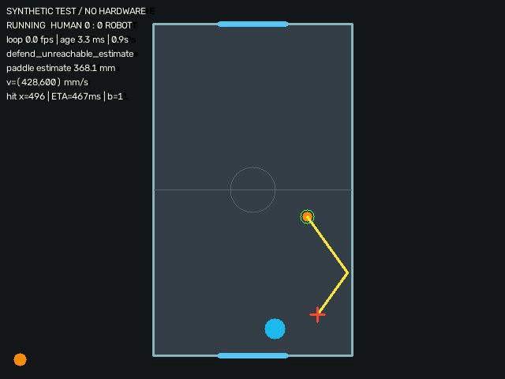

# Vision Air Hockey

**카메라 기반 퍽 추적과 벽 반사 예측을 이용하는 Raspberry Pi 자동 방어 에어하키.**

테이블 상단의 카메라 영상에서 퍽의 위치·속도를 추정하고, 측면 벽 반사를 고려한 방어 위치를 계산합니다. Raspberry Pi가 목표 좌표를 전달하면 별도 모터 제어 보드가 패들을 좌우로 이동합니다. 골대 센서와 RGB LED를 연결해 1인 체험 경기도 운영할 수 있습니다.

> **상태: 하드웨어 통합 전 프로토타입.** 소프트웨어 테스트와 합성 영상 실행을 확인했습니다. 실제 Raspberry Pi의 FPS, 카메라 오차, 모터 성능과 방어 성공률은 아직 측정하지 않았습니다. 기본 모드는 실제 모터를 움직이지 않는 `dry-run`입니다.



*합성 영상의 디버그 화면입니다. 화면의 속도·지연 수치는 실제 Raspberry Pi 성능 자료가 아닙니다.*

## 빠른 시작: 카메라 없이 확인

Python 3.10 이상이 있는 Linux 개발 환경에서 저장소 루트로 이동한 뒤 실행합니다. Raspberry Pi 카메라 설치는 다음 절을 따릅니다.

```bash
python3 -m venv .venv
source .venv/bin/activate
python -m pip install -e '.[headless]'

airhockey init-config config/local.json
airhockey run --config config/local.json \
  --source sim --start --auto-resume --seconds 20
```

실행 결과는 `runs/날짜_시각/`에 저장됩니다. 개인 설정과 실행 로그는 Git 추적에서 제외합니다. GUI가 필요하면 새 가상환경에 `.[desktop]`을 선택하고 실행 명령에 `--show --mask`를 추가합니다. `headless`와 `desktop`은 같은 `cv2` 패키지를 제공하므로 한 환경에서는 하나만 설치합니다.

기존 방식인 `python3 -m airhockey ...`도 지원합니다. `airhockey --help`, `airhockey-calibrate --help`에서 옵션을 확인할 수 있습니다.

## Raspberry Pi에서 시작

대상 장치는 **Raspberry Pi 4B 2GB + Camera Module 3 Wide**, 운영체제는 **Raspberry Pi OS**입니다. 테이블 치수와 모터·센서 모델은 `config/local.json`에서 실물에 맞춥니다.

```bash
bash tools/install_pi.sh
python3 -m airhockey init-config config/local.json
rpicam-hello --list-cameras

# 카메라 사진을 저장한 뒤 테이블 네 점과 퍽 색상을 보정합니다.
python3 -m airhockey.calibration snapshot \
  --config config/local.json --output calibration/table.png

# 보정 완료 후: 실제 카메라 + 모의 모터
python3 -m airhockey run --config config/local.json \
  --source camera --start --seconds 30
```

Picamera2는 Raspberry Pi OS의 apt 패키지를 사용합니다. PC용 OpenCV wheel을 Pi의 시스템 카메라 환경에 덮어쓰는 설치는 이 절차에 포함하지 않습니다. 화면 없이 코너·HSV 좌표를 지정하는 명령, 광각 렌즈 보정, 센서·모터 연결 순서는 [설치 및 운영 안내](docs/SETUP.md)에 있습니다.

**실제 모터 연결은 `--source camera --motor serial --arm --home`을 모두 지정해야 하며, 해당 실행은 원점 복귀를 시작합니다.** 시뮬레이션과 녹화 영상으로 실제 모터를 구동하는 조합은 거부합니다. 모터 제어 보드가 준비되면 [펌웨어 및 통신 명세](firmware/README_KO.md)를 확인합니다.

## 구현한 기능

| 단계 | 구현 내용 |
|---|---|
| 촬영 | Picamera2, 이미지와 센서 타임스탬프를 같은 요청에서 획득 |
| 좌표 보정 | 선택적 렌즈 왜곡 보정, 테이블 네 점의 호모그래피, 픽셀→mm |
| 퍽 검출 | HSV 범위, 면적·원형도, 테이블 영역, 이전 위치 연관 검사 |
| 속도 추정 | 실제 측정 시각에 대한 짧은 구간 선형 회귀 |
| 충돌 대응 | 벽 반사·패들 타격에 따른 방향 변화 후 새 표본으로 재추정 |
| 경로 예측 | 퍽 반지름을 포함한 다중 측면 벽 반사와 방어선 도착점 |
| 제어 | 프레임 지연 반영, 모터 가속·감속을 고려한 도착 가능성 추정 |
| 통신 | USB serial, 원점 복귀, 이동 범위 확인, 상태 응답·watchdog |
| 경기 | 골대 센서, 중복 득점 방지, RGB 표시, 기본 150초 운영 |
| 검증 | 합성 영상, 녹화 입력, 자동 테스트, CSV 로그, GitHub Actions |

## 알고리즘 개요

좌표의 원점은 사람 쪽 왼쪽 테이블 안쪽 모서리입니다. x는 오른쪽, y는 로봇 쪽으로 증가합니다. 모든 물리 계산은 **mm·mm/s·초** 단위를 사용합니다.

1. 영상을 보정하고 HSV 마스크에서 퍽 후보를 찾습니다.
2. 검출 위치를 테이블 좌표로 변환합니다.
3. 최근 위치와 촬영 시각을 이용해 `vx`, `vy`를 추정합니다.
4. `vy > 0`인 접근 경로에서 패들 앞쪽 방어선까지의 시간을 계산합니다.
5. 펼친 직선 경로를 테이블 폭에 맞춰 접어 측면 벽 반사를 계산합니다.
6. 촬영 이후 지난 시간을 차감하고 모터의 이동 시간을 평가합니다.
7. 범위 안의 목표를 전송하며, 새 프레임이 들어올 때마다 갱신합니다.

퍽 중심의 측면 반사 범위는 `[퍽 반지름, 테이블 폭 - 퍽 반지름]`입니다. 패들 중심선이 아니라 `paddle_y - paddle_radius - puck_radius`를 방어선으로 사용합니다. 이는 정면 접촉을 목표로 하는 간단한 모델이며, 마찰·회전·벽의 탄성 손실까지 예측하는 모델은 아닙니다.

수식, 코드 함수와의 대응, 오차 요인과 개선 방향은 [알고리즘 설명](docs/ALGORITHM.md), 전체 흐름과 상태 전이는 [소프트웨어 구조](docs/ARCHITECTURE.md)를 읽으면 됩니다.

## 코드 안내

| 경로 | 역할 |
|---|---|
| [`airhockey/app.py`](airhockey/app.py) | 입력·추적·예측·게임·모터를 연결하는 주 루프 |
| [`airhockey/vision.py`](airhockey/vision.py) | 카메라, 보정, 퍽 검출 |
| [`airhockey/tracking.py`](airhockey/tracking.py) | 위치 이력과 속도 추정 |
| [`airhockey/physics.py`](airhockey/physics.py) | 반사·도착 위치·이동 시간 계산 |
| [`airhockey/motor.py`](airhockey/motor.py) | 모의 모터와 USB 제어 인터페이스 |
| [`airhockey/game.py`](airhockey/game.py) | 경기 상태와 센서 디바운싱 |
| [`airhockey/io.py`](airhockey/io.py) | GPIO 이벤트·LED·운영자 입력 |
| [`airhockey/config.py`](airhockey/config.py) | 예제 설정과 실행 전 검증 |
| [`airhockey/calibration.py`](airhockey/calibration.py) | 사진·네 점·색상·렌즈 보정 CLI |
| [`airhockey/simulation.py`](airhockey/simulation.py) | 합성 카메라 입력 |
| [`config/example.json`](config/example.json) | 공개용 예제 설정, 실측값 아님 |
| [`firmware/`](firmware/) | 선택적 Arduino Uno STEP/DIR 참고 구현 |
| [`tests/`](tests/) | 물리·영상·통신·상태 전이·입력 검증 테스트 |

Python 패키지 설치·개발 도구 설정은 `pyproject.toml`에 모았습니다. Raspberry Pi 카메라용 Picamera2와 GPIO 의존성은 OS 패키지로 별도 설치합니다. Uno는 구매 목록에 포함됐다고 가정하지 않으며, 다른 제어 보드도 같은 프로토콜이나 모터 인터페이스로 연결할 수 있습니다.

## 경기 조작

| 터미널 명령 + Enter | 동작 |
|---|---|
| `start` | 경기 시작 |
| `pause` | 제어 감속 후 일시정지 |
| `resume` | 퍽 회수와 골대 센서 해제 후 재개 |
| `new` | 점수·시간 초기화 후 대기 |
| `quit` 또는 Ctrl+C | 모터 비활성화 및 종료 |

득점 후에는 운영자 재개를 기다립니다. 퍽 미검출이나 오래된 프레임에서는 이전 목표를 계속 추격하지 않고 `HOLD`로 감속합니다. 통신 장애·종료의 `STOP`은 홈 기준을 해제합니다. 원점 복귀와 스위치·구동부 설정은 실제 기구에 맞게 확인합니다.

## 개발·검증

```bash
python -m pip install -e '.[headless,dev]'
ruff check .
ruff format --check .
python -m unittest discover -s tests -v
python -m build
```

GitHub Actions는 Python 3.11/3.13에서 같은 정적 검사·테스트와 짧은 시뮬레이션, 패키지 빌드를 수행하도록 구성했습니다. 워크플로 파일이 있다는 사실만으로 원격 CI가 통과했다는 의미는 아닙니다. 실제 실행 이력은 업로드 후 저장소의 Actions에서 확인합니다.

[검증 기록](docs/VALIDATION_KO.md)에는 실제로 수행한 검사와 미검증 하드웨어 항목을 구분했습니다. 개선 방법과 PR 작성 기준은 [기여 안내](CONTRIBUTING.md), 처음 GitHub에 올리는 터미널 명령은 [GitHub 업로드 안내](docs/GITHUB.md)에 있습니다.

## 로그와 한계

`runs/날짜_시각/`에 `effective_config.json`, `telemetry.csv`, `summary.json`, `last_frame.png`가 생성됩니다. `motor_x_est_mm`는 엔코더 실측이 아닌 스텝 수 추정값이고, `reachable_estimate`는 이상적인 가속도 모델의 평가입니다.

- 실제 테이블 치수, 퍽/패들 반지름, 모터 이동 범위, HSV를 설정해야 합니다.
- Camera Module 3 Wide의 왜곡과 롤링 셔터는 예측 오차에 영향을 줍니다.
- 요청한 60fps와 실제 영상 처리 FPS는 다릅니다.
- 모터가 시간 안에 도달하지 못하면 예측이 맞아도 방어에 실패할 수 있습니다.
- 충돌·가림 후 재추정에는 새 표본을 얻는 시간이 필요합니다.
- 이 프로젝트는 딥러닝 모델 학습 없이 색상 검출과 물리 모델을 사용합니다.

실측 방어 성공률은 아직 없습니다. 임의의 정확도·성공률·실시간 성능 수치를 제시하지 않습니다.

## 라이선스와 외부 구성 요소

이 전달본은 배포 라이선스를 지정하지 않았습니다. 연구실·팀의 배포 방침에 맞춰 라이선스를 선택한 뒤 루트에 `LICENSE`를 추가하세요. 외부 라이브러리의 이름과 공식 문서는 [참고 자료](docs/REFERENCES.md)에 정리했습니다. 선택적 Arduino 예제는 AccelStepper 설치가 필요하며 해당 라이브러리 소스는 포함하지 않습니다.
