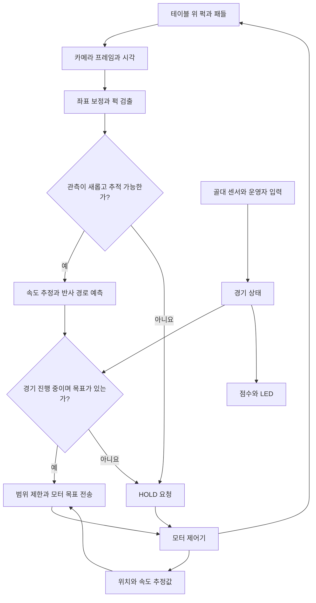

# 시스템 구조와 코드 읽기

이 프로젝트는 **카메라에서 얻은 퍽 위치를 테이블의 실제 좌표로 변환하고, 방어선에 도달할 위치를 계속 다시 계산하여 패들의 목표 위치를 보내는 제어 프로그램**이다. Raspberry Pi는 영상과 판단을 담당하고, 선택적으로 연결하는 모터 제어기는 스테퍼 펄스 생성과 원점 복귀를 담당한다.

실행과 설치는 [README](../README.md), 수식과 판단 기준은 [알고리즘 설명](ALGORITHM.md), 실제로 확인한 범위는 [검증 기록](VALIDATION_KO.md)을 먼저 확인한다. 아래 내용은 저장소의 구현을 설명한다. 실물 카메라의 처리 속도나 에어하키 방어 성공률을 측정한 결과는 포함하지 않는다.

## 1. 하드웨어와 소프트웨어의 역할

| 구성 요소 | 이 프로젝트에서의 역할 | 코드 경계 |
| --- | --- | --- |
| Raspberry Pi 4B + Camera Module 3 Wide | 영상 수집, 색상 기반 검출, 위치·속도 추정 | `PiCameraSource`, `Geometry`, `PuckDetector`, `PuckTracker` |
| Raspberry Pi의 제어 루프 | 예측 갱신, 경기 상태 확인, 목표 위치 명령 | `run_application()` |
| USB 연결 모터 제어기 | STEP/DIR 구동, 가속·감속, 원점 복귀, 제한 스위치·watchdog 처리 | `SerialMotor`와 예제 펌웨어 |
| 골대 센서 | 퍽 통과에 따른 디지털 입력 변화 | `GPIOInterface`, `GoalDebouncer` |
| RGB LED | 준비·진행·득점·정지 상태 표시 | `Game.color()`, `GPIOInterface.show()` |
| 운영자 | 시작·일시정지·득점 후 재개·경기 초기화 | `OperatorInput`과 화면 단축키 |

Pi에서 스테퍼의 각 펄스를 Python으로 직접 생성하지 않고, 테이블 좌표의 목표를 USB로 전달하도록 역할을 나누었다. 따라서 영상 처리 코드와 모터 보드 코드를 따로 개발하고 시험할 수 있다. 실제 보드가 예제 펌웨어와 다르면 [모터 인터페이스](../airhockey/motor.py)를 맞추거나 해당 프로토콜을 구현해야 한다.

## 2. 관측과 제어가 연결되는 구조

예측을 한 번 계산한 뒤 그대로 움직이는 방식이 아니다. 다음 프레임에서 관측한 위치가 달라지면 속도와 도착점을 다시 계산한다. 퍽의 관측에는 영상 피드백이 있지만, 예제 스테퍼 구동부의 위치 보고는 **발행한 스텝 수에 따른 추정**이다. 엔코더로 실제 패들 위치를 측정하는 피드백까지 구현된 것으로 해석하면 안 된다.

## 3. 프로그램 시작부터 종료까지

[메인 제어 루프](../airhockey/app.py)의 초기화와 실행 순서는 다음과 같다.

1. **실행 조건과 설정을 검사한다.** 실제 모터에는 `camera` 입력과 명시적인 `--arm --home`가 모두 필요하다. 녹화 영상이나 시뮬레이션을 실제 모터 입력으로 사용할 수 없다.
2. **카메라를 먼저 준비한다.** 첫 프레임은 시작 지연을 허용하고, 추가 프레임을 받아 초기 상태를 안정시킨다. 이 단계에는 아직 모터 연결을 열지 않는다.
3. **좌표 보정과 검출기를 만든다.** 코너가 없거나 보정 해상도가 다르면 여기서 실행을 멈춘다.
4. **모터를 연결한다.** 실제 모드에서는 프로토콜 버전, 이동 범위, 최대 속도, 가속도에 대해 Pi 설정과 펌웨어가 일치하는지 확인한 뒤 명시적으로 원점 복귀한다. 기본 dry-run 모드에는 실제 연결이 없다.
5. **골대 입력·운영자 입력·로그를 준비한다.** 경기 시작 전에는 `READY` 상태이며 목표를 계산해도 자동 경기를 시작하지 않는다. `--start`를 사용한 경우에도 골대 센서가 안정적으로 비어 있어야 시작한다.
6. **프레임마다 관측과 제어를 갱신한다.** 득점 이벤트와 운영자 명령을 먼저 적용하고, 새 프레임의 검출·추적·예측을 계산한다. 오래된 관측이나 추적 실패에는 `HOLD`를 요청한다.
7. **종료 시 모터 정지를 먼저 요청한다.** 이후 카메라·GPIO·파일을 닫고 마지막 화면과 요약을 저장한다. 파일 저장이나 카메라 종료 때문에 정지 요청이 뒤로 밀리지 않도록 순서를 정했다.

`HOLD`는 진행 중인 움직임을 감속하여 멈추려는 명령이다. 애플리케이션 종료의 `STOP`이나 제어기 비상 정지와 의미가 다르다. 통신 단절이나 처리 루프 정지에 대응하는 동작은 모터 제어기에도 구현되어야 한다.

## 4. 모듈별 책임과 주요 함수

| 파일 | 주요 클래스·함수 | 읽을 때 확인할 내용 |
| --- | --- | --- |
| [config.py](../airhockey/config.py) | `DEFAULTS`, `load_config()`, `validate()`, `defense_y()` | 단위와 기본값, 설정 병합, 유효성 검사, 방어선 위치 |
| [vision.py](../airhockey/vision.py) | `PiCameraSource`, `VideoSource`, `LensCorrection`, `Geometry`, `PuckDetector` | 동일 프레임의 영상·시각 수집, 렌즈 보정, 픽셀→mm 변환, HSV 검출 |
| [calibration.py](../airhockey/calibration.py) | `snapshot()`, `corners()`, `hsv()`, `lens()` | 실제 장치에 필요한 카메라·코너·색상 보정 |
| [tracking.py](../airhockey/tracking.py) | `PuckTracker.update()`, `association()`, `reset()` | 최근 표본 회귀, 다음 검출의 연관 위치, 충돌·가림 뒤 재획득 |
| [physics.py](../airhockey/physics.py) | `reflect_x()`, `predict_impact()`, `move_time_s()` | 여러 번 반사되는 x 좌표, 남은 시간, 모터 이동 시간 추정 |
| [motor.py](../airhockey/motor.py) | `DryRunMotor`, `SerialMotor` | 동일 API의 모의 구동·실제 통신, 위치 기준 변환, 상태 확인 |
| [game.py](../airhockey/game.py) | `GoalDebouncer`, `Game` | 센서 중복 득점 방지, 경기 상태·시간·점수 관리 |
| [io.py](../airhockey/io.py) | `GPIOInterface`, `OperatorInput` | GPIO 이벤트를 큐에 보관, 운영자 입력 수집, LED 출력 |
| [app.py](../airhockey/app.py) | `run_application()`, `annotate()` | 위 모듈을 연결하는 순서, 모터 명령 조건, 결과 기록 |
| [simulation.py](../airhockey/simulation.py) | `SimulationSource`, `demo_config()` | 합성 BGR 영상과 가상 센서 이벤트 생성 |
| [예제 펌웨어](../firmware/airhockey_motor/airhockey_motor.ino) | 명령 파서와 모터 상태 처리 | 실제 펄스 출력·홈·제한 스위치·watchdog의 예제 구현 |

처음 코드를 읽을 때는 `config.py → app.py → vision.py → tracking.py → physics.py` 순서가 좋다. 실제 모터를 연결하는 작업은 `motor.py`와 펌웨어를 함께 읽어야 하며, 득점 부분은 `game.py`에서 독립적으로 이해할 수 있다.

## 5. 모듈 사이에서 전달하는 데이터

| 객체 | 주요 필드 | 의미와 단위 |
| --- | --- | --- |
| `Frame` | `image`, `timestamp_s`, `sequence`, `metadata` | BGR 영상, monotonic 기준 촬영 시각(s), 애플리케이션 프레임 번호, 센서 메타데이터 |
| `Detection` | `x_mm`, `y_mm`, `pixel`, `radius_px`, `confidence` | 한 프레임에서 검출한 중심(mm), 보정된 영상의 중심(px), 외접원 반지름(px), 형태 점수 |
| `Track` | `timestamp_s`, `x_mm`, `y_mm`, `vx_mm_s`, `vy_mm_s`, `samples` | 최신 관측 위치와 최근 표본으로 추정한 속도(mm/s) |
| `Impact` | `x_mm`, `y_mm`, `remaining_s`, `capture_eta_s`, `frame_age_s`, `bounces`, `path` | 예측 방어점, 지금부터 남은 시간, 촬영 시점 기준 도달 시간, 프레임 나이, 반사 횟수·경로 |
| `MotorState` | `timestamp_s`, `position_mm`, `velocity_mm_s`, `homed`, `fault`, `mode` | 수신 시각, 테이블 기준 패들 위치·속도 추정값, 원점 복귀와 오류 상태 |

`Frame.sequence`는 앱이 프레임을 받은 횟수다. 센서의 모든 프레임이 빠짐없이 처리되었다는 의미는 아니다. `MotorState.timestamp_s`도 센서 촬영 시각과 달리 Pi가 상태 메시지를 처리한 시각이다.

카메라 모듈은 Picamera2의 `RGB888` 형식으로 얻은 배열을 OpenCV BGR 영상으로 사용한다. 이 이름과 메모리 채널 순서의 관계는 [Picamera2 공식 매뉴얼의 Image Formats 설명](https://datasheets.raspberrypi.com/camera/picamera2-manual.pdf)에 따른다.

## 6. 좌표와 설정의 공통 규칙

테이블의 인간측 왼쪽 안쪽 벽 교차점을 `(0, 0)`으로 둔다. `x`는 테이블 폭 방향, `y`는 인간측에서 로봇측으로 증가한다. 따라서 `vy > 0`이면 대체로 자동 패들 쪽으로 들어오는 퍽이다. 모든 물리 위치는 **퍽 또는 패들의 중심**을 기준으로 한다.

`vision.image_points`는 원본 snapshot에서 고른 네 코너다. 순서는 인간측 왼쪽 → 인간측 오른쪽 → 로봇측 오른쪽 → 로봇측 왼쪽이다. 코너를 영상의 x 값으로 자동 정렬하지 않는다. 카메라를 회전해서 설치했다면 물리적 순서를 유지해야 한다.

다음 값은 코드에 들어 있는 시작 예시이며 완성 테이블이나 모터의 실측 사양이 아니다.

| 설정 | 예시 기본값 | 단위·적용 범위 |
| --- | --- | --- |
| `camera.width`, `height`, `fps` | 640, 480, 60 | px, px, 요청 frames/s. 실제 속도는 로그로 확인 |
| `camera.exposure_us`, `analogue_gain` | 2000, 4.0 | µs, gain 배율. `exposure_us=0`은 자동 노출 |
| `camera.lens_position` | 1.0 | dioptre. 수동 초점 설정 |
| `table.width_mm`, `length_mm` | 600, 1000 | 안쪽 벽 사이 실측 mm |
| `table.puck_radius_mm`, `paddle_radius_mm` | 15, 30 | 실물 반지름 mm |
| `table.paddle_y_mm` | 920 | 패들 중심의 고정 y 위치 mm |
| `vision.calibration_size`, `image_points` | `[640,480]`, 미설정 | 보정 해상도와 원본 픽셀 코너 |
| `vision.min_area_px`, `max_area_px` | 20, 6000 | 윤곽선 면적의 픽셀². mm²가 아님 |
| `tracking.history_samples`, `min_samples` | 5, 3 | 회귀에 보관할 최대 표본 수, 시작 최소 표본 수 |
| `tracking.history_seconds`, `max_gap_s` | 0.10, 0.12 | 최근 관측 창과 재획득 기준 s |
| `control.max_frame_age_s`, `max_track_age_s` | 0.12, 0.08 | 오래된 영상·추적 결과의 사용 제한 s |
| `control.extra_latency_s` | 0.020 | 추가 전송·스케줄링 여유 s. 모터 이동 시간과 별개 |
| `control.command_hz`, `target_deadband_mm` | 30, 2 | 목표 명령의 최대 빈도와 갱신할 최소 위치 차이 |
| `motor.x_min_mm`, `x_max_mm` | 30, 570 | 패들 중심이 움직일 수 있는 테이블 x 범위 mm |
| `motor.max_speed_mm_s`, `max_accel_mm_s2` | 120, 600 | 구동부의 속도·가속도 설정. 실제 보드와 일치 필요 |
| `game.duration_s`, `goal_clear_s` | 150, 0.15 | 총 경기 시간, 센서 재활성화 전 비어 있어야 하는 시간 |
| `gpio.min_goal_pulse_s` | 0.002 | 유효한 센서 차단으로 볼 최소 시간 s |

설정 파일의 상대 `vision.lens_file` 경로는 설정 파일이 있는 폴더를 기준으로 해석한다. 모르는 설정 키는 `load_config()`가 거부하므로 철자 오류가 조용히 무시되지 않는다.

## 7. 득점과 경기 상태

센서 이름은 **센서가 설치된 골대**를 뜻한다. `robot_goal` 센서가 활성화되면 인간이 득점하고, `human_goal` 센서가 활성화되면 로봇이 득점한다.

| 현재 상태 | 입력·조건 | 다음 상태와 동작 |
| --- | --- | --- |
| `READY` | `start`, 양쪽 센서가 일정 시간 비어 있음 | `RUNNING`; 경기 시작 시각 설정 |
| `RUNNING` | 유효한 골대 이벤트 | `GOAL`; 해당 점수 +1, 퍽 회수 대기 |
| `RUNNING` | `pause` | `PAUSED`; 추적 기록 초기화와 HOLD |
| `PAUSED` 또는 `GOAL` | `resume`, 양쪽 센서가 비어 있음 | `RUNNING`; 새 관측으로 추적 재시작 |
| 시작한 경기 | 경기 시간 만료 | `FINISHED`; 방어 명령 종료 |
| 실행 중 | 처리·통신 오류 | `FAULT`; 종료 경로에서 STOP 요청 |
| 정상 운영 중 | `new` | `READY`; 점수와 경기 시작 시각 초기화 |

`new`는 소프트웨어 경기 초기화다. 모터 오류를 풀거나 원점 복귀를 대신하지 않는다. 오류로 프로그램이 종료된 경우 원인을 확인하고 다시 실행해야 한다.

경기 시간은 최초 시작 시각부터 흐르는 **전체 경과 시간**이다. 일시정지와 득점 후 퍽 회수 시간에도 타이머가 흐른다. 2~3분 체험 시간을 일정하게 유지하려는 현재 구현이며, 순수 경기 시간만 세려면 `Game`의 시간 누적 방식을 변경해야 한다.

### 중복 득점을 막는 방법

`GPIOInterface`의 콜백은 활성·비활성 변화와 시각만 큐에 넣는다. `GoalDebouncer`는 이 이벤트를 순서대로 처리한다. 센서가 비어 있는 상태를 `goal_clear_s` 이상 확인하면 준비되고, 이후 차단이 `min_goal_pulse_s` 이상 지속되면 한 번의 골 이벤트를 만든다. 퍽이 센서를 계속 가려도 다시 득점하지 않는다. 다음 득점에는 다시 안정적인 비차단 상태가 필요하다.

이 구조는 두 카메라 프레임 사이에 생긴 짧은 센서 펄스도 큐에 남길 수 있다. 다만 GPIO 장치가 실제 펄스를 포착했는지와 OS 스케줄링 지연은 실물에서 확인해야 한다. GPIO 핀 번호는 [gpiozero의 기본 BCM 번호 규칙](https://gpiozero.readthedocs.io/en/stable/api_input.html)을 사용한다.

경기 상태별 LED는 준비 흰색, 진행 초록, 일시정지 파랑, 인간 득점 빨강, 로봇 득점 노랑, 종료 청록, 오류 자홍이다. 프로그램이 종료되면 GPIO 리소스를 닫으면서 LED도 꺼진다.

## 8. 모터 명령이 나가는 조건

실제 목표는 다음 조건을 모두 통과한 뒤 계산한다.

- 경기가 `RUNNING`이고 관측 시각이 오래되지 않았다.
- 최근 관측 수가 충분하며 비정상 속도·방향 변화 때문에 재획득 중이지 않다.
- 퍽이 방어선 쪽으로 접근하고, 방어선까지 양의 시간이 남아 있다.
- 예측 위치를 패들 중심의 허용 범위로 제한한다.

퍽이 로봇 반대편으로 이동하면 `return_to_center` 설정에 따라 중앙으로 돌아갈 수 있다. 퍽이 보이지 않거나 예측이 유효하지 않으면 새로운 위치를 임의로 만들지 않고 `HOLD`를 요청한다.

`reachable_estimate=0`이어도 유효한 예측이 있으면 허용 범위의 목표 쪽으로 이동을 시도한다. 이 값은 “계산상 마감 시간까지 정지 완료가 어려움”을 알려주는 진단값이며, 실제 방어 성공·실패의 판정값이 아니다.

앱은 모터 상태 확인 전의 시각을 계속 재사용하지 않는다. `poll()`이 끝난 뒤 시각을 다시 읽고, 최종 목표에 촬영 시각 기반의 `expires_at_s`를 붙인다. `set_target()`은 내부 상태 확인 뒤에도 기한을 재검사해 이미 만료됐다면 새 MOVE 없이 HOLD하고 `False`를 반환한다. 정상 전송 시에는 `True`다. 직렬 쓰기와 USB 전송 자체의 소요 시간까지 확정하는 하드 실시간 보장은 아니며, 추가 지연 여유와 실제 측정이 필요하다.

통신 상태 확인은 메인 루프에서 이루어진다. 영상 처리가 멈췄는데 별도 스레드가 heartbeat만 계속 보내는 구조를 피했다. Pi는 오래된 상태·응답을 감지하고, 예제 MCU는 자체 watchdog으로 통신 진행이 중단되었을 때 동작을 정지한다. 시간 제한 값은 [motor.py](../airhockey/motor.py)와 [펌웨어](../firmware/airhockey_motor/airhockey_motor.ino)에 함께 정의되어 있다.

## 9. 결과 파일을 읽는 방법

각 실행 폴더에는 적용 설정, 시간순 CSV, 요약 JSON, 마지막 화면이 저장된다. 같은 출력 폴더에 기존 결과가 있으면 실행을 거부하여 결과를 덮어쓰지 않는다.

| CSV 필드 | 확인할 질문 |
| --- | --- |
| `frame_age_ms`, `processing_ms` | 영상을 받았을 때 이미 늦었는가, 처리 과정에서 시간이 얼마나 들었는가? |
| `detected`, `track_samples` | 퍽 자체를 못 찾는가, 찾았지만 속도를 확정할 표본이 부족한가? |
| `x_mm`, `y_mm`, `vx_mm_s`, `vy_mm_s` | 실측 좌표와 방향·속도가 납득할 만한가? |
| `target_x_mm`, `bounces`, `remaining_s` | 반사를 포함한 목표 위치와 남은 시간이 어떻게 바뀌는가? |
| `command_x_mm` | 실제로 마지막 전송한 목표가 예측값과 얼마나 다른가? |
| `motor_x_est_mm`, `motor_v_est_mm_s` | 구동부가 보고한 스텝 기반 추정 위치·속도는 무엇인가? |
| `move_time_s`, `reachable_estimate` | 현재 모터 제약으로 목표에 도달하고 정지할 시간이 남았는가? |
| `game_state`, `human_score`, `robot_score`, `reason` | 경기 상태 또는 어떤 분기 때문에 방어·HOLD가 선택되었는가? |

`target_x_mm`은 계산 결과이고 `command_x_mm`은 마지막 전송 목표다. 범위 제한, 전송 주기, deadband 때문에 둘이 다를 수 있다. 실제 패들 위치를 비교하려면 별도 영상 추적이나 엔코더 측정값이 필요하다.

## 10. 모의 실행의 의미

시뮬레이션은 퍽 좌표를 추적기에 곧바로 주입하지 않는다. 먼저 합성 BGR 영상을 만든 다음 실제와 같은 `Geometry → PuckDetector → PuckTracker → predict_impact` 경로를 사용한다. 따라서 색상 마스크, ROI, 좌표 변환, 속도 추정과 제어 분기의 연결을 확인할 수 있다.

실제 렌즈 왜곡, 반사광, 가림, 모션 블러, 센서 읽기 시간, 모터 토크와 스텝 손실은 모의 영상과 모의 모터가 재현하지 않는다. 시험이 통과했다는 것은 이 구현의 특정 입력·출력 조건이 맞는다는 의미이며, 실물 성능 검증을 대신하지 않는다.
